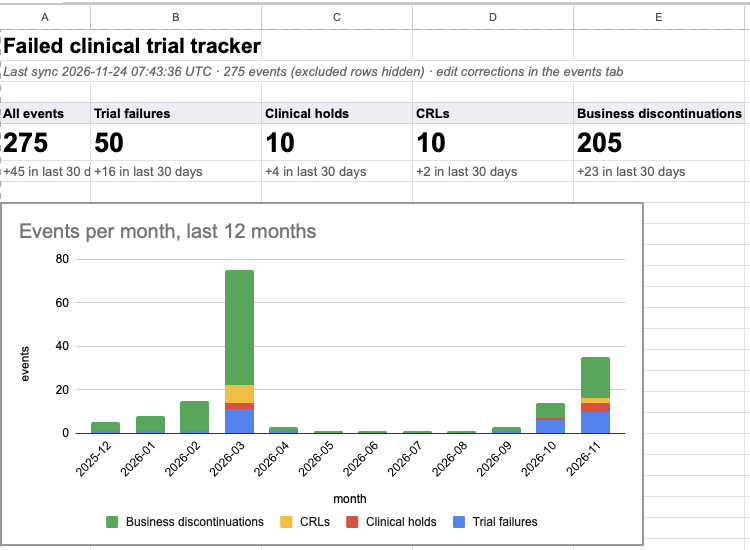
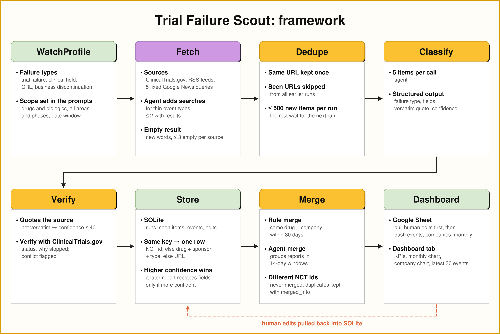
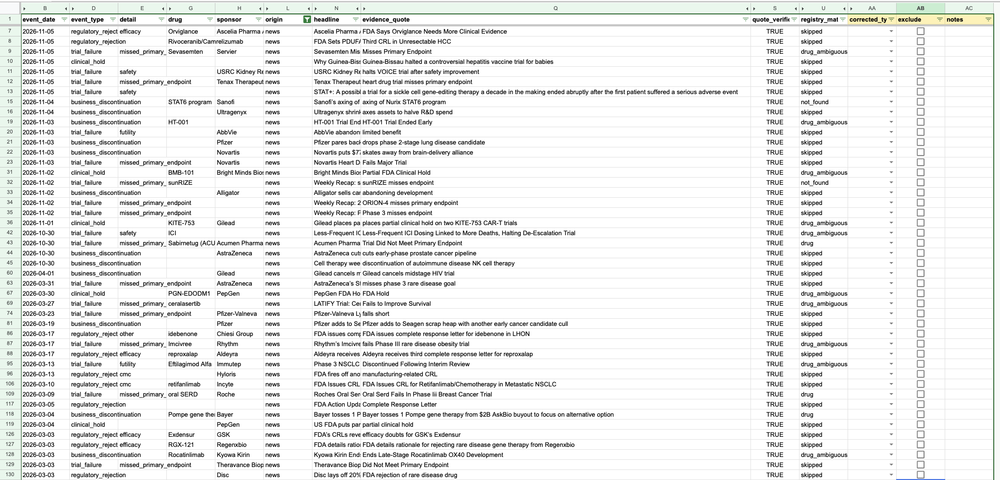

# Trial Failure Scout

An LLM agent that collects news about **failed clinical trials** into a SQLite database: missed primary endpoints, futility or safety stops, FDA clinical holds, complete response letters (CRLs), and discontinued programs. It then mirrors the database to a Google Sheet that has a built-in dashboard.

A single command fetches everything published since the last run. It classifies each item with Claude Haiku, checks the result against ClinicalTrials.gov, merges duplicate reports of the same event, and syncs everything to the sheet.

```
scout run --since 2026-03-01 --until 2026-03-31
```

> The structure is adapted from Jam with AI's **Job Scout** ([Build your own Job Agent, part 1](https://jamwithai.substack.com/p/build-your-own-job-agent-part-1) · [part 2](https://jamwithai.substack.com/p/build-your-own-job-agent-part-2)). Job Scout searches job boards and scores postings against a résumé. Trial Failure Scout keeps the same skeleton (model-chosen queries, a cascade of sources, batched structured scoring, a grounding check) and applies it to drug-development news.



*Dashboard tab of the Google Sheet. Data from two runs (a March 2026 backfill and one week in November), so the March spike reflects the backfill, not a trend; most rows are ClinicalTrials.gov withdrawals and terminations.*

---

## Design

### Framework



The main loop is written by hand, without an agent framework. Every LLM call is a plain Anthropic SDK call: tool use for planning searches, structured output for classifying and merging.

### Key decisions

- **Collect everything first, filter later.** What counts as a "failure" is decided afterwards. Every event is stored with an `event_type`; to get only the cases where the drug didn't work, select `trial_failure` plus `regulatory_rejection` with `crl_reason = efficacy`.
- **Agent picks the query word.** Code runs every source first (the registry, the trade-press feeds and 5 fixed Google News queries), so coverage does not depend on the model. The agent then sees each fixed query's result count and sample titles and adds Google News searches only for event types that look thin (up to 2 with results, at most 4 attempts). One broad query chosen by the agent was tried first and starved whole event types, because Google News returns only about 10–20 items per query ([Supplementary S7](docs/design-details.md#s7-design-log-what-failed-first)).
- **Evidence and verification.** The classifier must quote the sentence that supports its label; code checks that the quote appears verbatim in the source (ignoring case and whitespace) and caps confidence at 40 if it doesn't. Extracted drug and sponsor names are matched loosely against the same text. Events with an NCT id or a drug name (except CRLs, which have no registry record) are then looked up on ClinicalTrials.gov: the trial's status and "why stopped" text are stored next to the news claim, and when they disagree, the event is flagged instead of being silently resolved.
- **Event merge.** Each row is an event, not an article. Reports with the same event key are attached to one row when stored; reports with different keys are merged by a rule and then by the agent, combined with union-find. Different NCT ids are never merged, and duplicates are kept with `merged_into` set, so nothing is deleted.
- **Humans stay in the loop.** The Google Sheet has editable columns (`corrected_type`, `exclude`, `notes`). They are pulled back into SQLite before every push and stored apart from the agent's output.

Design details: [`docs/design-details.md`](docs/design-details.md).

---

## Results

### Eval

The eval set is 26 hand-labelled items in `fixtures/examples.json` (21 real news items and registry records, 5 synthetic edge cases):

- 13 trial failures, 4 CRLs, 4 business discontinuations, 1 clinical hold
- 4 negatives that look similar but are not events (a successful Phase 3 readout, an approval, a trial stopped early for efficacy, a device trial that failed)

| Field | Score |
|---|---|
| `event_type` | **26 / 26** |
| `failure_type` (where labelled) | 10 / 10 |
| `crl_reason` (where labelled) | 4 / 4 |
| `partial` (where labelled) | 20 / 20 |
| evidence quote is verbatim | 22 / 22 |

Last run on 2026-11-24: 6 API calls, $0.004.

```
scout eval     # re-runs the classifier on the fixtures and prints a score for each field
```

The set is small and was built while the prompt was being written. It works as a regression test, not as a measure of real-world accuracy.

### Cost (Claude Haiku)

Every API call of `scout run` and `scout merge` is logged in SQLite (`llm_calls`) with its token counts and estimated cost. The two runs predate the merge step inside `scout run`; merging was done once afterwards (the merge-pass row).

| Run | Window | Items fetched | Events stored | LLM calls | Cost |
|---|---|---|---|---|---|
| Backfill | March 2026 (1 month) | 268 | 201 | 55 | **$0.055** |
| 1-week run | 1 week (2026-10-30 to 11-06) | 220 | 113 | 46 | **$0.044** |
| Merge pass | whole database | — | 314 → 275 | 8 | **$0.008** |

Each run covers the window from `--since` to `--until`; both can be set to any dates. By default `--until` is today and `--since` is where the last run ended, and URLs seen in an earlier run are never classified again, so regular weekly runs cost about as much as the 1-week row. Building the current database (275 distinct events) cost about **$0.11** in total; 229 of the events come from ClinicalTrials.gov records and 46 from news.



### Known weaknesses

Like Job Scout, the project records its weaknesses before trying to fix them:

- **Too many registry records.** Most `business_discontinuation` rows come from ClinicalTrials.gov records whose `whyStopped` says "sponsor decision" or "funding". They are real events but tell you little.
- **Paywalls and blocked sites.** Endpoints and Fierce Biotech block non-browser clients (403) and are not used; for many Google News results, only the headline and snippet are available.
- **Google News redirect links** are not decoded: the stored link is the Google News redirect, and only the publisher's homepage is kept alongside it.
- **Ambiguous readouts** such as interim analyses, subgroup failures, or "missed the primary endpoint but hit a secondary one" are flagged with `partial = true`, but they are still the hardest cases.
- **The eval set is small** (26 items, 5 of them synthetic) and was not kept separate from prompt development.
- **Human edits can be lost after a merge.** On the first sync after a merge, the sheet still holds both the merged-away row and the canonical row; whichever comes later wins, so an empty row can clear a correction made on the other. Not fixed yet.

---

## Usage

```bash
uv venv .venv && uv pip install --python .venv/bin/python -e '.[dev]'
source .venv/bin/activate
export ANTHROPIC_API_KEY=...

scout run --since 2026-03-01 --until 2026-03-31   # fetch → classify → verify → store → merge → sync
scout run                                        # since the last run (first run: last 7 days)
scout --db /tmp/offline.db run --offline --since 2026-01-01   # fixtures instead of fetched sources, scratch database (still calls the APIs)
scout list --type trial_failure
scout show NCT04676360                           # one event: fields, verification, URLs
scout companies --min 2                          # companies with event counts
scout runs                                       # past runs with API calls and cost
scout merge                                      # re-merge the whole database
scout eval                                       # classifier accuracy on the fixtures
scout sync                                       # Google Sheet: pull edits, push events
pytest                                           # offline tests, no API calls
```

Environment variables:

| Variable | Purpose |
|---|---|
| `SCOUT_MODEL` | model for classifying and merging, default `claude-haiku-5-5` |
| `SCOUT_PLANNER_MODEL` | planner model, default `claude-haiku-5-5` |
| `SCOUT_DB` | database path, default `scout.db` |
| `SCOUT_SHEET_ID` | turns on Google Sheet sync at the end of `scout run` |
| `SCOUT_GOOGLE_CREDENTIALS` | service-account key, default `~/.config/failure-scout/google.json` |

The SQL views `v_events_all`, `v_events`, `v_companies` and `v_monthly` apply human edits. Example queries are in [`sql/queries.sql`](sql/queries.sql).

**Google Sheet (optional).** To mirror the database to a sheet:
1. In Google Cloud, create a service account, enable the Google Sheets API, and download its JSON key to `~/.config/failure-scout/google.json` (or set `SCOUT_GOOGLE_CREDENTIALS`).
2. Create a Google Sheet and share it with the service account's `client_email` as Editor.
3. Set `SCOUT_SHEET_ID` to the id in the sheet's URL. `scout sync` (and every `scout run`) then rebuilds the tabs.

### Layout

```
src/failure_scout/
  planner.py     fixed searches + extra searches chosen by the model (tool use)
  sources.py     ClinicalTrials.gov, Google News RSS, trade-press RSS, fixtures
  classify.py    batched structured classification + verbatim-quote check
  verify.py      field check + ClinicalTrials.gov cross-check (no LLM)
  merge.py       rule-based + LLM event merging, union-find
  companies.py   sponsor-name normalisation
  models.py      pydantic data models (NewsItem, FailureEvent)
  db.py          SQLite schema, upserts, views
  sync.py        two-way Google Sheet sync
  dashboard.py   rebuilds the dashboard tab in the sheet on every sync
  usage.py       token and cost log for every call
  cli.py         the `scout` command
```

---

Google News RSS is for personal, non-commercial use only. This is a personal learning project and is not affiliated with Jam with AI.
