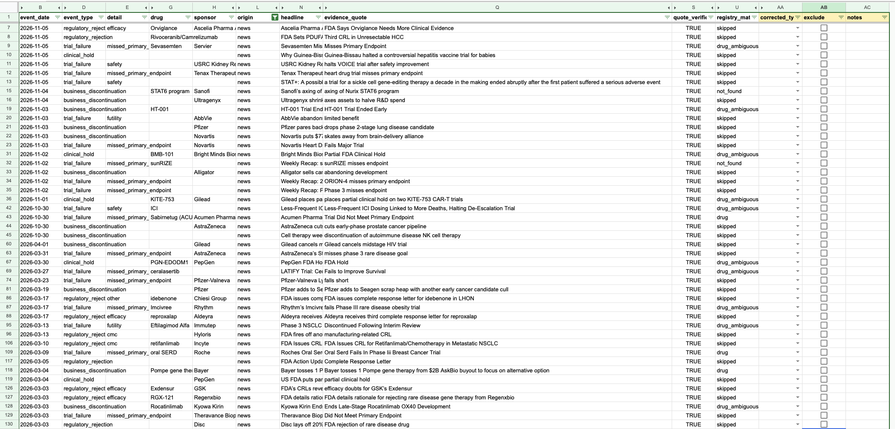

# Trial Failure Scout: design details

Companion to the [README](../README.md), which gives the overview, the framework figure, key decisions, results and usage. This file covers each pipeline step, the data model, data sources, reliability, limitations, the Google Sheet layout, the prompts and the design log.

## Pipeline steps

0. **WatchProfile (the scope).** It sets what one run looks for. There is no profile object in the code: the values are fixed in the prompts and source filters ([Supplementary S2](#s2-watchprofile-as-implemented)).
   - 4 failure types (plus `not_an_event` for everything else);
   - drugs and biologics only;
   - all therapeutic areas and all phases;
   - date window: `until` = today; `since` = the `until` date of the last run (first run: 7 days before `until`). Both can be set with `--since` / `--until`.
1. **Fetch.**
   - **Data sources** ([data sources](#data-sources)). Code first pulls ClinicalTrials.gov, two trade-press RSS feeds and 5 fixed Google News queries (one or two per event type), with no LLM.
   - **Agent picks query words.** The agent gets the 5 fixed queries with their result counts and first 5 titles. It may call `search_news` on Google News (the only source it can search) for an event type that looks thin or off-topic. It stops by replying without a tool call.
   - **Loop for small fetch result.** Code counts the agent's searches per source:
     - a search with results counts toward the limit of 2 extra searches with results;
     - a search with 0 results does not count toward that limit; up to 3 empty results are allowed per source (the first plus 2 retries), and the third closes the source;
     - once 2 searches with results or 3 empty ones have been used, any further search returns an error message to the agent instead of searching (so at most 4 agent searches).
   - **Planning loop stops** when the agent replies without a tool call, on a refusal, an API error, a reply cut off at `max_tokens`, or after 8 LLM calls (a `pause_turn` reply continues the loop). Every source has already been searched by code, so a failed planning step only loses the extra searches.
   - **Robustness.** No source raises: Google News and each feed return [] on error; ClinicalTrials.gov keeps the pages already fetched.
2. **Dedupe (before any LLM cost).**
   - An item found by several queries is kept once (by URL).
   - URLs seen in any earlier run (the `seen_items` table) are skipped, so they are never classified again.
   - At most 500 new items go on to classification; the rest stay unseen for the next run. Items are taken in fetch order (registry, RSS, Google News), so Google News items are the first to wait.
   - Only exact URLs are compared. Reports of the same event from different outlets have different URLs, and Google News gives redirect links, so the same article found through Google News and an RSS feed also passes. These are joined in step 6.
3. **Classify (based on failure type).**
   - The agent labels the new items 5 per call, 4 calls in parallel, with structured output: event type (see [FailureEvent](#failureevent)), failure type or CRL reason, partial or not, drug, sponsor, indication, phase, NCT id, date, a verbatim evidence quote, and a confidence score.
   - Code then cleans each result:
     - `failure_type` is kept only for `trial_failure`, and `crl_reason` only for `regulatory_rejection`;
     - if the agent gives no NCT id, the registry record's own id is used;
     - for registry records, the event date is the actual stop date (for withdrawn trials, which never ran, and records without a plausible stop date: the date stated in the text, else the record's last-update date); for news, the date stated in the text, else the publish date;
     - the event key is set: the NCT id, else drug + sponsor + event type, else the URL;
     - the quote check from step 4 runs here (in `classify.py`), because it needs only the source text.
   - `not_an_event` items are marked as seen but not stored as events.
   - If a call fails, is refused or is cut off, or the agent skips an item, those items are not marked as seen, so they are retried in the next run.
4. **Verification (quotes the source and verifies with ClinicalTrials.gov).** Code only, no LLM; events are checked 4 at a time. No check raises: a failed lookup is recorded as `error`.
   - **Quote.** The evidence quote must appear verbatim in the source title or text (ignoring case and spacing); if it does not, `quote_verified` is false and confidence is capped at 40.
   - **Fields.** Each extracted field must appear in the source text, otherwise it is listed in `unverified_fields`:
     - drug: the full name, or every part of a combination ("A + B");
     - sponsor: the full name, or one distinctive word of it ("Roche" for "Hoffmann-La Roche"; generic words such as "Pharmaceuticals" do not count);
     - NCT id: in the text, or the record's own id.
   - **Verify with ClinicalTrials.gov** (API v2; the result is recorded in `registry_match`):
     1. **Skip when no lookup is needed.** If the item is itself a registry record, that record is used (`source`). CRLs, and events with neither an NCT id nor a drug, are `skipped` (a CRL has no registry record).
     2. **Look up by NCT id.** If the event has an NCT id, that study is fetched directly (`nct`). If the request fails, the result is `error`, with no fallback to step 3.
     3. **Otherwise search by drug.** The API is searched by intervention (the drug name) and sponsor, newest update first, up to 10 trials; if nothing is found, the search is repeated with the drug alone, because sponsor names vary ("Roche" vs "Hoffmann-La Roche"). The most recent stopped trial (terminated, suspended or withdrawn) is used, or the most recent overall if none has stopped. One trial found → `drug`; several → `drug_ambiguous`.
     4. **Nothing found** → `not_found`.
     5. **Store the registry's view** next to the news claim: the matched NCT id, its status, its "why stopped" text, its stop date (for a stopped trial) and the number of candidates.
   - **Conflict flag.** Set when all three hold:
     - the match is certain (`nct` or `drug`, not ambiguous);
     - the event says the trial stopped (clinical hold, business discontinuation, or a trial failure for futility or safety; a missed endpoint does not count);
     - the registry still lists it as recruiting, not yet recruiting, or enrolling by invitation.
   - The conflict is shown, not resolved.
5. **Store and review (SQLite ⇄ Google Sheet).**
   - Everything is stored in SQLite (`runs`, `seen_items`, `events`, `edits`, `llm_calls`). Each event has a key (set in step 3): the NCT id, else drug + sponsor + event type, else the URL. A later report with the same key is attached to the existing row; it replaces the fields only if its confidence is higher, and the row's `event_type` is never replaced.
   - It is mirrored to a Google Sheet with a dashboard tab. `scout run` syncs automatically at the end of the run, after step 6, when `SCOUT_SHEET_ID` is set (`--no-sync` turns this off).
   - Corrections made in the sheet (`corrected_type`, `exclude`, `notes`) are pulled back before every push. They are stored apart from the agent's output, so the extraction itself can still be evaluated (except that a merge in step 6 overwrites the canonical row's type).
6. **Merge (duplicate events merged).** Runs on the rows already stored in SQLite.
   - Reports with different keys are merged in two passes:
     1. by a rule: same drug and company (names normalised), within 30 days;
     2. by the agent, which groups reports in overlapping 14-day windows (one every 7 days, at most 60 lines per call). Only news events open a window; a registry record joins a window when its company appears in that window's news and its date is within 60 days.
   - Union-find combines the groups and never joins two different NCT ids. In each group the canonical row is a registry record if there is one, else one that names a drug, else the most confident; when the agent grouped the reports, its `event_type`, `failure_type` and `crl_reason` are set to the agent's group label (groups formed by the rule alone keep the canonical row's type), and its empty fields are filled from the duplicates. Duplicates are kept with `merged_into` set; nothing is deleted.
   - `scout run` merges only events dated from 74 days before `since` to 74 days after `until` (one 14-day window plus the 60-day registry allowance); events without a date are left out. `scout merge` re-merges the whole database.
   - This step comes after classification because duplicates often differ in fields (drug, NCT id, event type) that exist only after classifying ([Supplementary S7](#s7-design-log-what-failed-first)).
7. **Models and tools.**
   - **Agent:** Claude Haiku (`claude-haiku-5-5`) through the Anthropic Python SDK. It is used three times: tool use to pick search keywords, structured output to classify items, and structured output to merge duplicates. Response schemas are defined with pydantic.
   - **Data sources:** ClinicalTrials.gov API v2; Google News RSS; BioPharma Dive and STAT RSS feeds. Feeds are fetched and parsed with the Python standard library (`urllib`, `xml.etree`).
   - **Storage and review:** SQLite; Google Sheets through `gspread`.
   - **Development:** pytest (offline tests), uv (environment).

## FailureEvent

Structured output is used, so a reply from the model in the wrong format fails at this step.

**What counts as a failure (decided 2026-11-06).** Everything is collected first and told apart by `event_type`, then filtered as needed. To look only at failed trials, select `trial_failure`, plus `regulatory_rejection` with `crl_reason = efficacy`.

- `event_type`:
  - `trial_failure`: the primary endpoint was not met, or the trial stopped early for futility or safety;
  - `clinical_hold`: FDA halted all or part of a trial;
  - `regulatory_rejection`: a CRL (FDA letter refusing approval);
  - `business_discontinuation`: dropped for commercial or strategic reasons;
  - `not_an_event` (added during implementation): positive results, approvals, opinion pieces, device trials, anything else.
- `failure_type` (only for `trial_failure`): `missed_primary_endpoint` / `futility` / `safety`.
- `crl_reason` (only for `regulatory_rejection`): `efficacy` / `safety` / `cmc` (manufacturing quality) / `labeling` / `other`. Every CRL is kept, including those about manufacturing or labeling.
- `partial`: true / false. Marks cases where only one arm stopped, only part of a trial was put on hold, or the primary endpoint failed while a secondary endpoint was met.
- `drug`, `sponsor`, `indication`, `phase`, `nct_id` (may be empty).
- `event_date`, `source_url` (stored as the list `source_urls`, one per report).
- `evidence_quote`: the sentence in the source that supports the label. It must be copied from the source; the model may not rewrite it. This guards against fabrication.
- `confidence`: 0–100.

**Confidence scoring.** The rules below are what the classifier prompt and the code actually apply. The prompt gives no finer bands.

| Rule                                                                                                                                      | Where                |
| ----------------------------------------------------------------------------------------------------------------------------------------- | -------------------- |
| `confidence` is how sure the agent is of `event_type`, given only this item's text, on a 0–100 scale                                      | classifier prompt    |
| A headline alone rarely justifies more than 80                                                                                            | classifier prompt    |
| A registry record whose "why stopped" text is empty or vague is labelled `not_an_event` with low confidence                               | classifier prompt    |
| If the evidence quote cannot be found verbatim in the source, confidence is capped at 40                                                  | code (`classify.py`) |
| When several reports share one event key, a later report replaces the fields only if it is more confident; `event_type` is never replaced | code (`db.py`)       |

*As implemented, also stored:*
- `quote_verified` and `unverified_fields`;
- the registry fields `registry_match`, `registry_nct`, `registry_status`, `registry_why_stopped`, `registry_stop_date`, `registry_candidates` and `registry_conflict`;
- `event_key`, `publisher_urls` (the publisher's homepage, one per report);
- database columns only: `company_key` (normalised sponsor) and `merged_into`.

## Data sources

Queried in order. Each one had to be checked for usability first.

| #   | Source (v0 plan)                                                                                                                                                                                              | Status                                                                                                                                                                                                                                                                                                                                     |
| --- | ------------------------------------------------------------------------------------------------------------------------------------------------------------------------------------------------------------- | ------------------------------------------------------------------------------------------------------------------------------------------------------------------------------------------------------------------------------------------------------------------------------------------------------------------------------------------ |
| 1   | **ClinicalTrials.gov API v2.** No key needed, structured data. Query trials with status TERMINATED / WITHDRAWN / SUSPENDED and read the `whyStopped` field. Serves both as a data source and for verification | Used: every stopped drug or biologic trial whose record was updated in the window (the update usually, not always, falls near the stop); all pages, up to 500 records                                                                                                                                                                      |
| 2   | **openFDA CRL database** (not verified). A structured source of CRLs. Published CRLs are reported to be heavily redacted, so coverage needs checking first                                                    | Not used                                                                                                                                                                                                                                                                                                                                   |
| 3   | **Trade press:** BioWorld, BioSpace, FierceBiotech, RTTNews, CancerNetwork. The first few came up repeatedly when collecting examples                                                                         | Partly: every article in the BioPharma Dive and STAT (biotech) RSS feeds published in the window. The feeds keep only about 2 days and 1 week, so they help weekly runs, not backfills. FierceBiotech (and Endpoints) return 403                                                                                                           |
| 4   | **Press releases:** GlobeNewswire, BusinessWire, etc., searched with keywords such as "did not meet primary endpoint", "discontinue", "complete response letter"                                              | Reached through Google News rather than queried directly                                                                                                                                                                                                                                                                                   |
| 5   | **Google News RSS search.** No key needed, wide coverage, but noisy                                                                                                                                           | Used: 5 fixed queries (one or two per event type), plus searches chosen by the agent (up to 2 with results, at most 4 attempts); window set with `after:` / `before:`; about 10–20 results per query, at most 50 kept                                                                                                                      |
| 6   | **Annual roundups**, e.g. Xtalks' "Clinical trial failures of 2026", as seed data or to check recall                                                                                                          | Not used                                                                                                                                                                                                                                                                                                                                   |
| 7   | **Offline cache.** A batch of hand-labelled news committed to the repository, so the tool runs when every online source is down; also used by the tests                                                       | Used: 26 fixtures (`fixtures/examples.json`: 21 real items, 5 synthetic edge cases) for `--offline`, the tests and `scout eval`. `--offline` replaces every fetched source (and skips planning), but classification and merging still call the Anthropic API, and verification still calls ClinicalTrials.gov. The tests run fully offline |

## Reliability

| Risk | What guards against it |
|---|---|
| **Fabricated evidence** | The quote must appear verbatim in the source; if it doesn't, confidence is capped at 40 |
| **Wrong extracted fields** | The drug, sponsor and NCT id must appear in the source text, otherwise they are listed in `unverified_fields` |
| **News contradicting the record** | ClinicalTrials.gov lookup by NCT id or drug name; a "stopped" claim against a "recruiting" record raises a conflict flag instead of being resolved silently. In the current database only the 46 news events are cross-checked (the 229 registry events are their own record): 3 matched one trial, 10 matched several, 2 found nothing, 31 were skipped (CRLs, or no drug name), and 1 conflict was flagged |
| **Missed event types** | 5 fixed queries (one or two per event type), plus agent searches for thin spots and up to 2 retries after an empty result |
| **Duplicates** | Event key (NCT id, else drug + sponsor + type), then a rule merge and an agent merge; different NCT ids are never merged; duplicates are kept with `merged_into`, never deleted |
| **Malformed model output** | Structured output; an item that fails classification is not marked as seen, so it is retried in the next run |
| **A source going down** | Every source returns [] on error and the run continues; `--offline` runs on the fixtures instead of fetched sources (it still needs the Anthropic API and the ClinicalTrials.gov lookup) |
| **Model errors that get through** | Human review in the sheet (`corrected_type`, `exclude`, `notes`), stored separately from the agent's output, so the extraction itself can still be evaluated (except for types overwritten by a merge) |
| **Regressions** | `scout eval` on 26 hand-labelled fixtures (21 real, 5 synthetic); 21 offline tests |

## Limitations and next steps

**Known weaknesses** (recorded before fixing, as in Job Scout):
1. **Too many registry discontinuations.** Most `business_discontinuation` rows are registry records with vague reasons, such as "sponsor decision".
2. **Paywalls.** Often only the headline and snippet are available.
3. **Google News redirect links** are not decoded: the stored link is the Google News redirect, and only the publisher's homepage is kept alongside it.
4. **Ambiguous readouts.** Interim and subgroup readouts are flagged `partial`, but they are still the hardest cases.
5. **Small eval set.** 26 items (5 of them synthetic), built during prompt writing, so not held out.
6. **Human edits can be lost after a merge.** On the first sync after a merge, the sheet still holds both the merged-away row and the canonical row; whichever comes later wins, so an empty row can clear a correction made on the other. Not fixed yet.

**Next steps:**
- **Held-out evaluation from real runs** (Job Scout Part 2's "traces become datasets"): sample real items, label them by hand, and report precision and recall per event type.
- **Check the agent's merges:** compare merge decisions with hand-labelled pairs, and between repeated runs.
- **Decode Google News links** to reach the article text.

## Google Sheet view



*The `events` tab, filtered to news rows, with some machine columns hidden. The database was built on 2026-11-06 with an earlier classifier prompt, so a few `drug` values (e.g. "ICI", "STAT6 program") are descriptions that the current prompt no longer allows.*

The sheet is rebuilt from SQLite on every `scout sync` (and at the end of `scout run` when `SCOUT_SHEET_ID` is set). It has 5 tabs:

| Tab | Content |
|---|---|
| `events` | one row per event, newest first; merged duplicates are hidden, excluded rows stay visible so they can be un-excluded |
| `companies` | event counts per normalised company (`v_companies`) |
| `monthly` | event counts per month, type and origin (news or registry; `v_monthly`) |
| `dashboard` | KPI cards (total and last 30 days per type), a monthly stacked chart, a company bar chart and the latest 30 events; built from non-excluded events |
| `about` | last sync time, number of events, and how to edit |

Columns of the `events` tab:
- **Machine columns** (rewritten on every sync; editing them shows a warning): the event fields (`event_type`, `detail`, `partial`, `drug`, `sponsor`, `indication`, `phase`, `nct_id`, …), the source (`origin`, `n_reports`, `headline`, `publisher`, `first_url`), the evidence (`evidence_quote`, `confidence`, `quote_verified`, `unverified_fields`), the registry check (`registry_match`, `registry_status`, `registry_why_stopped`, `registry_stop_date`, `registry_conflict`) and `model_event_type`.
- **Human columns** (yellow header, pulled back before every push):
  - `corrected_type`: a dropdown with the 4 real event types (`not_an_event` is not accepted; use `exclude` instead);
  - `exclude`: a checkbox (true / yes / 1 / x / y / ✓ also count); excluded rows are left out of `v_events`, the `companies` and `monthly` tabs and the dashboard;
  - `notes`: free text.
- An edit made on a row whose event is later merged away moves to the canonical event.

## Supplementary

### S1. Environment variables and company names

**Environment variables.**

| Variable | Default | Purpose |
|---|---|---|
| `SCOUT_MODEL` | `claude-haiku-5-5` | model for classification and merging |
| `SCOUT_PLANNER_MODEL` | `claude-haiku-5-5` | model for planning searches |
| `SCOUT_DB` | `scout.db` | SQLite path (also `--db`) |
| `SCOUT_SHEET_ID` | none | Google Sheet id; when set, `scout run` syncs at the end |
| `SCOUT_GOOGLE_CREDENTIALS` | `~/.config/failure-scout/google.json` | service-account key for the sheet |

**Company names** (`companies.py`). Sponsor names are normalised into a `company_key`, used by the rule merge (same company), `scout companies` and the `v_companies` view:
- accents and possessives are removed, and a trailing appositive is cut ("Kanyos Bio, Inc., a wholly owned subsidiary of …" → "kanyos");
- legal forms are dropped anywhere (Inc, Ltd, AG, GmbH, Holdings, …), and generic industry words are dropped from the end (Therapeutics, Pharmaceuticals, Bio, …), so "Aldeyra Therapeutics, Inc." → "aldeyra";
- an alias table unifies names that normalisation cannot: Hoffmann-La Roche and Genentech → roche, Kite → gilead, GlaxoSmithKline → gsk, Bristol Myers Squibb → bms, MSD → merck, Janssen → johnson johnson, Eli Lilly → lilly, and a few more. It is extended by hand as duplicates show up.

### S2. WatchProfile (as implemented)

There is no `WatchProfile` class in the code. The scope below is fixed and lives in four places: the planner prompt, the classifier prompt, the ClinicalTrials.gov filter, and the fixed Google News queries.

| Field             | Value                                                                                                                                                             | Where it is applied                                                                                                              |
| ----------------- | ----------------------------------------------------------------------------------------------------------------------------------------------------------------- | -------------------------------------------------------------------------------------------------------------------------------- |
| Event types       | `trial_failure`, `clinical_hold`, `regulatory_rejection`, `business_discontinuation` (+ `not_an_event`)                                                           | planner and classifier prompts; 5 fixed queries (1–2 per type)                                                                     |
| Intervention      | Drugs and biologics only (small molecules, antibodies, vaccines, cell and gene therapies); devices, diagnostics, procedures and behavioural interventions are out | classifier prompt; ClinicalTrials.gov filter `AREA[InterventionType](DRUG OR BIOLOGICAL)`                                        |
| Therapeutic areas | All                                                                                                                                                               | no filter                                                                                                                        |
| Phases            | All                                                                                                                                                               | no filter (phase is extracted as a field)                                                                                        |
| Date window       | `since` = the `until` date of the last run (first run: today − 7 days); `until` = today; both can be set with `--since` / `--until`                                            | ClinicalTrials.gov `LastUpdatePostDate` range; Google News `after:` / `before:` in the query; RSS items filtered by publish date |
| Registry status   | `TERMINATED`, `SUSPENDED`, `WITHDRAWN`                                                                                                                            | ClinicalTrials.gov `filter.overallStatus`                                                                                        |

Fixed Google News queries (5 in total, one or two per event type; run by code before the agent plans):

| Label | Query |
|---|---|
| missed_endpoint | `"primary endpoint" trial "did not meet" OR "failed to meet" OR misses OR fails` |
| stopped_futility_safety | `trial stopped OR halted OR discontinued futility OR "interim analysis" OR safety` |
| clinical_hold | `"clinical hold" FDA` |
| regulatory_rejection | `"complete response letter"` |
| business_discontinuation | `biotech discontinues OR deprioritizes OR scraps drug program` |

### S3. Planner prompt (fetch step; `planner.py`)

System prompt:

```text
You plan searches for a tool that collects failed clinical trial events into a database. Event types wanted: trials that missed their primary endpoint or stopped for futility or safety; FDA clinical holds; FDA complete response letters (any reason); programs discontinued for business reasons. Drugs and biologics only, not medical devices.

ClinicalTrials.gov and the publisher feeds have already been fetched in full, and one or two Google News searches per event type have already been run (two for trial failures: missed endpoint, and stopped for futility or safety); the user message lists them with result counts and sample titles.

You may run up to 2 more Google News searches, only for an event type whose fixed search looks thin or off-topic. If nothing looks thin, run none. If a search returns 0 results, try different keywords. When done, stop calling tools and reply with one line summarising what you added.
```

Tool (`strict: true`):

```text
name: search_news
description: Search Google News for failed-trial events in the run's date window (the window is applied automatically). Returns the number of results and a few sample titles. `query` uses Google search syntax: quoted phrases, OR between alternatives, e.g. '"did not meet" primary endpoint phase 2'. Results are capped at ~10-20 per query, so keep each query on one event type.
input: { source: "gnews", query: string }
```

User message:

```text
Date window: {since} to {until}.

Fixed Google News searches already run:

[missed_endpoint] gnews: {query}
{n} results ({new} new this run).
- {title 1}
- … (up to 5 titles)

… (one block per fixed query)

Now run your searches.
```

Each tool result has the same "{n} results ({new} new this run)" form. Code enforces the caps: once 2 searches with results or 3 empty ones have been used for a source, any further search returns an error to the agent instead of searching.

### S4. Classifier prompt (classify step; `classify.py`)

System prompt:

```text
You label news items and trial-registry records about drug development.

For each item, decide which event it reports:
- trial_failure: a trial missed its primary endpoint, or was stopped for futility, lack of efficacy, or safety. Set failure_type to missed_primary_endpoint, futility, or safety.
- clinical_hold: a regulator (usually FDA) halted all or part of a trial.
- regulatory_rejection: a complete response letter (CRL) or other refusal to approve. Set crl_reason: efficacy (evidence of benefit judged insufficient), safety, cmc (manufacturing / quality), labeling, or other.
- business_discontinuation: a program or trial dropped for business, strategic, funding, or enrollment reasons, not because the data failed.
- not_an_event: positive results, approvals, opinion or market pieces, trials stopped early because they succeeded, or anything else.

Scope is drugs and biologics only (small molecules, antibodies, vaccines, cell and gene therapies). Medical devices, diagnostics, surgical procedures and behavioural interventions are out of scope: label them not_an_event even if the trial failed.

Registry records (source ClinicalTrials.gov) carry a "Why stopped" text: low enrollment, funding, or sponsor decisions are business_discontinuation; lack of efficacy or futility is trial_failure; toxicity or deaths is trial_failure with failure_type safety. If "Why stopped" is empty or vague, use not_an_event with low confidence.

Set partial=true when only one arm, cohort, or part of a trial is affected, a hold is partial, or the primary endpoint failed while a secondary succeeded.

evidence_quote must be copied verbatim from the item's title or text: the shortest span that supports your label. Never paraphrase it.

drug must be a specific name or code (e.g. "reproxalap", "BMB-101", "PGN-EDODM1"). Descriptions such as "partnered drug", "oral immunology drug", "STAT6 degrader" or "ICI" are not names: use null.

Use null for fields the item does not state. Dates as YYYY-MM-DD. confidence is 0-100: how sure you are of event_type given only this text (headlines alone rarely justify above 80).

Return exactly one result per item, with index matching the item's [index].
```

User message (5 items per call):

```text
[0] source: {source} | published: {date or unknown}
title: {title}
text: {snippet or (none)}

[1] …
```

The reply is parsed into the FailureEvent schema (see [FailureEvent](#failureevent)).

### S5. Merge prompt (merge step; `merge.py`)

System prompt:

```text
You deduplicate a database of drug-development events. Each line is one stored event, built from one news report or one trial-registry record.

Group lines that describe the same real-world occurrence: the same drug or program and the same announcement, e.g. one trial readout, one complete response letter, one clinical hold, one decision to drop a program. Coverage of that occurrence by different outlets, or follow-up stories within days, belongs in the same group even when one report names the drug and another only the company, or when the reports were labelled with different event types.

Keep separate: different trials of the same drug (different NCT ids), different drugs of the same company, and separate occurrences such as a clinical hold and its later lifting, or a first and a second CRL. A registry line joins a news group only if it is the registry record of the very trial the news is about.

Return only groups with two or more lines. For each group give the event_type, failure_type (trial_failure only) and crl_reason (regulatory_rejection only) that best describe the occurrence, judging from all its lines. If nothing should be merged, return an empty list.
```

User message (one line per stored event in a 14-day window):

```text
[{i}] {event_date} | {event_type/failure_type/crl_reason} | drug: {drug} | company: {sponsor} | {nct_id or no NCT} | {news or registry}: {headline, ≤140 chars} | quote: {evidence_quote, ≤160 chars}
```

Code then checks each group (indices in range, at least 2 members) and applies it through union-find, which refuses to join two different NCT ids.

### S6. Mapping from Job Scout (from the first design, 2026-11-06)

| Job Scout                                                                 | Trial Failure Scout                                                                                   |
| ------------------------------------------------------------------------- | ----------------------------------------------------------------------------------------------------- |
| Upload a résumé, parse it into a `Profile`                                | Write a watch scope, parsed into a `WatchProfile` (which areas, which phases, how recent the news is) |
| `search_jobs` tool, search words chosen by the model                      | `search_news` tool, search words chosen by the model                                                  |
| 4 job sources queried in turn, plus an offline cache                      | Several news sources and trial databases queried in turn, plus an offline cache                       |
| Scores 5 jobs per batch (0–100)                                           | 5 news items per batch: decide the event type and extract the fields                                  |
| Quality bar: at least 5 jobs scoring 60 or more                           | Stop after every source has been queried once                                                         |
| At most 2 retries                                                         | When a source returns nothing, retry with new search words, at most 2 times; plus a cap on LLM calls  |
| Part 2 adds a judge that checks against the résumé to prevent fabrication | Check against ClinicalTrials.gov, so that a successful trial is not reported as a failure             |
| Opik tracing, baseline batch                                              | Opik tracing as well, and a baseline batch                                                            |

*As implemented:* the `WatchProfile` is not parsed from user text; the scope was fixed as all areas and phases and is written into the prompts and source filters ([Supplementary S2](#s2-watchprofile-as-implemented)). The SQLite usage log replaced Opik. See Supplementary S7.

### S7. Design log: what failed first

What failed in the first version, and how it was fixed.

| First version | What went wrong | Fix |
|---|---|---|
| One broad Google News query, chosen by the agent | Google News returns only about 10–20 items per query; one run found 0 CRLs, the next found 6 | 5 fixed queries (one or two per event type), run by code; the agent only adds searches |
| Deduplicate before classifying | Duplicates often differ in fields that only exist after classification | Skip seen URLs before classifying; merge stored events after verification |
| openFDA CRLs, FierceBiotech and Endpoints as sources | FierceBiotech and Endpoints return 403 to non-browser clients; openFDA's CRL coverage was uncertain in the v0 notes and was not pursued | Dropped; press releases arrive through Google News |
| Opik tracing (planned) | Not set up | Usage log in SQLite instead, queryable next to the data |
